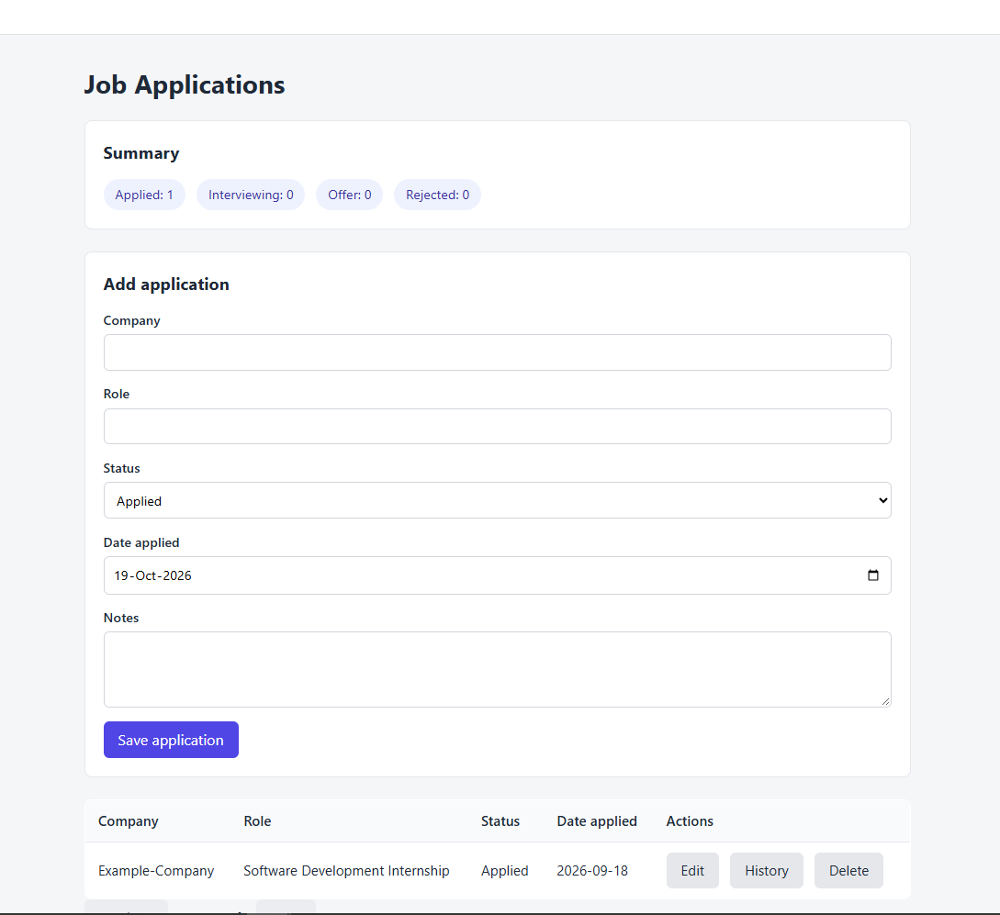

# Job Application Tracker

A full-stack app for tracking job applications through each stage of the process: Applied, Interviewing, Offer, or Rejected. It has a summary view of how many applications are in each status.

Built with ASP.NET Core and React to practise connecting a C# backend to a TypeScript frontend.



## Features

- Create, edit, and delete applications
- Track company, role, status, date applied, and notes
- Summary of applications by status
- Validation on the client and the server

## Tech stack

**Back end**
- ASP.NET Core Web API (.NET 10)
- Entity Framework Core with SQLite
- Scalar for interactive API documentation

**Front end**
- React with TypeScript, built with Vite

## Project structure

```
job-tracker/
  api/        ASP.NET Core Web API (models, DbContext, migrations, endpoints)
  web/        React app (components, API client)
```

## API endpoints

| Method | Route | Purpose |
|---|---|---|
| GET | `/api/applications` | List all applications, newest first |
| GET | `/api/applications/{id}` | Get one application |
| POST | `/api/applications` | Create an application |
| PUT | `/api/applications/{id}` | Update an application |
| DELETE | `/api/applications/{id}` | Delete an application |
| GET | `/api/applications/summary` | Count applications per status |

Interactive docs are available at `/scalar/v1` when the API runs in Development.

## Getting started

### Prerequisites
- .NET 10 SDK (or 8 or later)
- Node.js LTS

### Run the API

```bash
cd api
dotnet run
```

Open `http://localhost:5216/scalar/v1` to see the endpoints.

### Run the web app

In a second terminal:

```bash
cd web
npm install
npm run dev
```

Open `http://localhost:5173`.

The API creates `jobtracker.db` in the `api` folder on first run. The database is excluded from Git.

## Running the tests

The API has integration tests that start the application in memory and send real HTTP requests. They use a separate SQLite file for each run, so they never touch your `jobtracker.db`.

From the root folder:

```bash
dotnet test
```

The tests cover:

- Creating an application and receiving an assigned `Id`
- Rejecting a create request with an empty company name
- Returning `404 Not Found` for a missing record
- Updating an application's status
- Deleting an application and confirming it's gone
- Returning a count for every status in the summary

## Design decisions

- **Separate API and front end.** The API is a self-contained service, so a different client could use it later.
- **Status stored as text.** EF Core saves the enum as a string (`Applied`, not `0`), which makes the database readable and keeps the API output clear.
- **Migrations applied on startup.** `Migrate()` runs when the API starts, so a fresh clone needs no manual database setup.
- **Validation in two places.** The form checks required fields before sending, and the API checks again, since the API can't assume every client validates.
- **Summary always returns all statuses.** Statuses with no records return `0`, so the front end never has to handle missing keys.
- **Form resets with a key.** Editing uses a React `key` tied to the selected record, so the form loads its values without an effect.

## Known limitations

- No user accounts or authentication. Anyone who can reach the API can read and change its data.
- No encryption of stored data.
- CORS allows only `http://localhost:5173`, so the app runs locally only.
- The database is a local SQLite file, not suitable for multiple servers.

## What I'd add next

- Styling and responsive layout
- Sorting and filtering by status or date
- Deployment to a hosted service

## Author

Marco Ndhukula